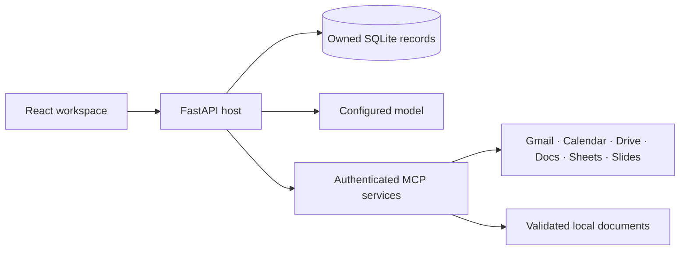

# Architecture and permissions

The React application talks to one FastAPI host. The host coordinates the configured model, authenticated MCP services, approvals, persistence, and generated files. Google connectors use the signed-in user's account. The default runtime is live; mock mode is explicit and isolated.

## Responsibilities

- `apps/web`: routes, reusable components, feature hooks, and network services.
- `apps/api`: authentication, agent execution, model transport, approvals, owned records, and operations.
- `mcp-servers`: independently packaged Google and local-document tool providers.
- `packages/mcp-common`: shared schemas, permissions-related contracts, Google transport, and isolated fixtures.
- `packages/shared-types`: generated browser API contracts.
- `tests` and `evaluations`: cross-service verification and packaged deterministic datasets.

Server packages do not import the API host or one another. Shared packages do not import applications. `make architecture-check` verifies those boundaries.

## Request execution and recovery

A conversation message creates an owned, idempotent run. The model selects validated tools; the host calls real MCP transports and saves checkpoints after successful reads. SSE carries model phases, tool activity, streamed text, and terminal state. Model deadlines are bounded by the remaining workflow budget.

Model-facing evidence removes duplicate fields and limits text structurally. Complete tool results remain stored for inspection. Search previews do not establish full-message reads, and truncated content must be disclosed.

Multi-message Gmail reads use a bounded batch tool. Model calls advertise relevant connector schemas; once a read-only email summary has all selected messages, final synthesis uses plain untrusted evidence without further tool negotiation.

`POST /api/runs/{id}/retry` creates an idempotent continuation at a saved read-only model boundary. It preserves the failed run and original conversation turn, rechecks current permissions and consent, and refuses stale or effectful checkpoints. Run responses expose recovery eligibility and retrieval counts. No database migration is needed for this metadata.

## Trust boundaries

Google OAuth establishes account identity and incremental connector grants. Credentials are encrypted in the local vault. HttpOnly application sessions and CSRF protect browser mutations. Owned queries and MCP caller assertions constrain every user's access.

Model processing requires consent bound to the configured endpoint and model. Retrieved emails and documents remain untrusted evidence. Tool arguments are validated against server schemas even if a model-facing projection is simpler.

Google writes require approval for the exact account, tool, arguments, and target snapshot. Draft creation and sending are separate approvals. Unknown write outcomes require provider inspection, rather than automatic replay. Local document generation is separately validated and owner-restricted.

## MCP usage

The Explorer and `/api/mcp/tools` show the current authorized tool catalog; they replace a handwritten tool list. Services support authenticated HTTP and stdio entrypoints. Use `workspace-ai mcp --help` and the independent SDK example in `examples/multi-server-workflows/independent_mcp_client.py` for client integration. Tokens are short-lived caller assertions, never Google credentials.

## Files and data

Local artifacts support validated DOCX, PDF, XLSX, PPTX, CSV, Markdown, and sanitized HTML, with provenance and owner-only downloads. Native Google documents use provider readback and retain Google links. Structural readback is distinct from visual review in Office applications.

Live storage, credentials, browser state, artifacts, and generated verification remain under ignored local directories. Preserve the encryption key separately when backing up or restoring. See [setup](setup.md) for operational commands and [development](development.md) for checks.
