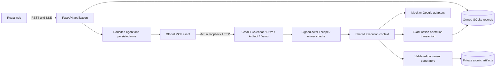

# Architecture diagram

The runtime remains one backend process. Package boundaries organize implementation; the MCP arrows remain real network calls. Stdio is available through the host CLI as a separate transport.
