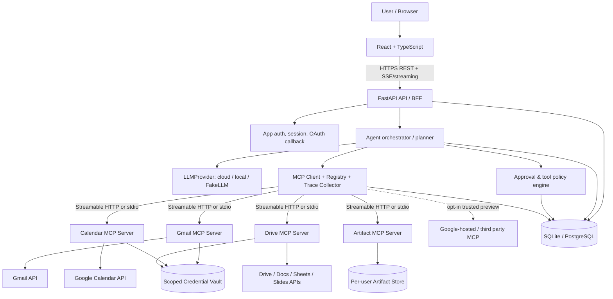

# Technical architecture and implementation details

## 0. Architectural principles
1. **Actual MCP, not a wrapper.** Agent orchestration talks to MCP servers via the official SDK client and protocol transport. Provider adapters are private to MCP servers. UI calls backend APIs, never Google directly.
2. **Modular monolith first.** Limit idle memory, operational complexity and debugging burden. Host several independently addressable MCP ASGI endpoints in a single process for development if supported, or small isolated processes where simpler. Prove independent connection with MCP Inspector and cross-process tests. The runtime boundary is MCP, even when components share repository/database infrastructure.
3. **Policy enforcement close to action.** Orchestrator and MCP tool both enforce risk, identity, scopes, resource ownership and approval; never rely on LLM to behave.
4. **Offline by design.** Provider protocol uses interchangeable mock and live backends. All critical tests use synthetic data and deterministic fake model.
5. **Explicit data movement.** Artifacts are referred to by opaque IDs, not arbitrary host paths. Sources are structured, and sensitive content is not copied into logging/audit by default.
6. **Evolvable contracts.** Version MCP schema, app API and typed artifact specifications. Inspect remote MCP schema and opt-in to trust, with hash pinning.

## 1. High-level architecture


**Protocol detail:** MCP 2026-07-28 has a stateless core and modern request metadata; Streamable HTTP uses POST at MCP endpoint. Do **not** assume `initialize` or `Mcp-Session-Id` is part of modern protocol. The official Python SDK evolves; write compatibility tests against a pinned stable release, and if implementing fallback to earlier revisions explicitly version/negotiate and document it. App chat sessions are separate from MCP transport context.

## 2. Suggested repository structure
```text
mcp-workspace-ai/
├── AGENTS.md
├── README.md
├── Makefile
├── pyproject.toml              # uv workspace and dependency declarations
├── uv.lock
├── pnpm-workspace.yaml
├── pnpm-lock.yaml
├── .env.example
├── .gitignore
├── docker-compose.yml
├── apps/
│   ├── api/
│   │   └── src/workspace_api/
│   │       ├── main.py
│   │       ├── routes/            # chat, conversation, artifacts, connectors, approvals, health
│   │       ├── auth/              # app auth, Google OAuth PKCE, token vault
│   │       ├── orchestration/     # model adapters, tool loop, plan manager
│   │       ├── mcp_client/        # registry, transport, discovery, schema validation
│   │       ├── policy/            # tool risk, approval service, authz
│   │       ├── persistence/       # SQLAlchemy models, repositories, alembic
│   │       ├── tracing/           # trace events, redaction, usage metrics
│   │       └── schemas/           # public REST/events/contracts
│   └── web/
│       ├── src/
│       │   ├── app/
│       │   ├── features/chat/
│       │   ├── features/mcp-explorer/
│       │   ├── features/connectors/
│       │   ├── features/approvals/
│       │   ├── features/artifacts/
│       │   ├── components/ui/
│       │   ├── lib/api.ts
│       │   └── types/
│       └── tests/
├── packages/
│   ├── core/                    # common typed schemas, error codes, clock/IDs, auth context
│   ├── google_adapters/         # mock/live provider interfaces and decoding/pagination
│   ├── artifact_engine/         # typed IR, docx/pdf/xlsx/pptx renderer and validators
│   ├── mcp_gmail/               # independent MCP entrypoint/server
│   ├── mcp_calendar/
│   ├── mcp_drive/
│   ├── mcp_artifacts/
│   └── mcp_demo/                 # external-composable sample server
├── migrations/
├── tests/
│   ├── unit/
│   ├── contract/
│   ├── integration/
│   ├── security/
│   ├── fixtures/synthetic/
│   ├── e2e/
│   └── evaluation/
├── scripts/
│   ├── seed_demo.py
│   ├── smoke_mcp.py
│   ├── run_eval.py
│   ├── verify_artifacts.py
│   └── reset_demo.py
├── examples/
│   ├── prompts.md
│   ├── fixture_walkthrough.md
│   └── expected_traces/
├── docs/
│   ├── IMPLEMENTATION_PLAN.md
│   ├── ISSUE_BACKLOG.md
│   ├── ARCHITECTURE.md
│   ├── OAUTH_SETUP.md
│   ├── SECURITY.md
│   ├── MCP_PROTOCOL.md
│   ├── EVALUATION.md
│   ├── DEMO_SCRIPT.md
│   ├── FINAL_HANDOFF.md
│   └── ADRs/
└── .github/workflows/ci.yml
```
Structure is a strong default, not a command to create empty placeholders. Codex may adjust to SDK ergonomics but must document changes and preserve modular boundaries.

## 3. Component responsibilities and interfaces
### 3.1 Frontend
Use typed REST API + streaming events (`GET /.../events` over SSE or fetch streaming; pick actual implementation). Pages: `/chat/:id?`, `/artifacts`, `/connectors`, `/mcp`, `/approvals`, `/settings`. Keep per-turn events keyed by conversation ID and trace ID; browser reconnection should load persisted state and avoid replayed writes. Never store OAuth/access/refresh tokens in localStorage. Sessions via secure HttpOnly SameSite cookies with CSRF protection for mutations.

Front-end state types: `Message`, `StreamEvent`, `ToolTrace`, `PendingApproval`, `Artifact`, `SourceRef`, `ConnectorStatus`, `McpServerStatus`, `ModelConfig`. Use discriminated unions to represent queued/running/needs_approval/completed/failed/cancelled. Provide error boundary and network retry UI.

### 3.2 Backend API (proposed routes; implement OpenAPI)
| Method/path | Action | Auth |
|---|---|---|
| `GET /api/health` | process heartbeat | public, minimal |
| `GET /api/ready` | database and MCP connectivity status | operator/limited |
| `POST /api/auth/demo` | create local demo-only session | demo config only |
| `GET /api/auth/google/start?connector=...` | OAuth authorization initiation, state/PKCE | app session |
| `GET /api/auth/google/callback` | validate and exchange code | state+PKCE |
| `POST /api/connectors/{id}/disconnect` | revoke/delete credentials | app session+CSRF |
| `GET /api/connectors` | status and granted scopes | app session |
| `GET /api/conversations` | list own chats | app session |
| `POST /api/conversations` | create own chat | app session |
| `GET /api/conversations/{id}` | messages and traces | owner |
| `POST /api/conversations/{id}/messages` | submit user turn and start execution | owner+CSRF |
| `GET /api/runs/{id}/events` | stream progress/tool/approval/final | owner |
| `POST /api/runs/{id}/cancel` | cancel pending tool run | owner+CSRF |
| `GET /api/runs/{id}/trace` | redacted MCP execution trace | owner |
| `GET /api/approvals` | active approvals | owner |
| `POST /api/approvals/{id}/decide` | approve/reject signed action | owner+CSRF |
| `GET /api/artifacts` | list generated files | owner |
| `GET /api/artifacts/{id}` | metadata | owner |
| `GET /api/artifacts/{id}/download` | safe streaming download | owner |
| `DELETE /api/artifacts/{id}` | delete own artifact | owner+CSRF |
| `GET /api/mcp/servers` | trusted servers, health, transport/version | owner |
| `GET /api/mcp/tools` | sanitized registered schemas/permissions | owner |
| `POST /api/mcp/servers` | register a trusted allowlisted remote | admin-only/P1 |
| `GET /api/export/my-data` | user data export | owner/P1 |

Input/output typed with JSON Schema/OpenAPI. Use cursor pagination and content truncation. Backend enforces ownership and permissions on every route, not just via UI.

### 3.3 Agent orchestration
Layered pipeline:
1. Validate and store user turn, identity, granted connector capabilities and applicable policy.
2. Build bounded context: recent messages + grounded prior state; never entire inbox or all Drive content.
3. Refresh/cached MCP tool registry; include only allowed schemas and least-risk tools in LLM tool selection.
4. Ask LLM for structured next step. Validate chosen `server.tool`, tool argument JSON and authority; reject unknown/untrusted tools.
5. For reads, execute MCP request, normalize results to `ToolResult`, keep source handles; redact/limit retrieved text, treat as untrusted data. For writes, create immutable `ActionProposal` with digest and policy. Pause if approval required.
6. Resume only when exact approval validated; issue tool call with one-time approval capability; record actual effect and provider IDs.
7. Continue reasoning up to bounded max steps. Produce grounded final answer and optional artifacts. Avoid aggressive autonomous multi-app actions when user only asked a question.
8. Store turn, trace, source references, user-visible state; collect metrics.

**Prompt injection boundary:** Never interpolate an email as a system/developer instruction. Tool outputs have 'untrusted data' role/channel. Validate the planned action independent of model. A source asking to send the inbox elsewhere remains text to summarize, not a command.

**Planner strategy:** Start with a simple single-agent deterministic bounded loop and typed tool definitions, **not** a complex multi-agent graph. For workflows that need confirm-and-resume, use persisted step state; if a framework is used (OpenAI Agents SDK / LangGraph), justify it with tested MCP transport integration and no duplicated state machine. Avoid premature orchestration framework lock-in.

### 3.4 MCP client registry
`McpServerDefinition` fields: stable id, display name, transport `streamable_http|stdio`, URL/command (server-side only), expected protocol versions, auth mode, owner, enabled, trust level, allowed tools, pinned schema digest, health and timeout. Distinguish host-auth from Google OAuth. Stdio commands must be internally built/allowlisted; never accept user-controlled shell strings.

Client methods: `discover(server)`, `list_tools(server)`, `list_resources(server)`, `list_prompts(server)`, `call_tool(server, name, args, identity, deadline, trace_id)`, `read_resource(...)`, `get_prompt(...)` and `close()`. Reuse connection pooling only where current SDK supports it. Support timeouts, retries only on idempotent calls, cancellation, normalized error types, redaction and exposure of protocol metadata.

**Modern MCP HTTP guardrails:** POST with required headers according to negotiated revision; validate Origin on server, bind to loopback locally, authenticate all requests; no unprotected remote ports. Return typed content/result, validate output shape and cap size. Use documented per-request auth/metadata; do not hardcode legacy sessions/initialize. Compatibility adapter should be separate and opt-in, not silently downgrade security.

`ToolDescriptor`: `qualified_name`, `server_id`, `input_schema`, `output_schema?`, `annotations`, `risk`, `required_scopes`, `schema_sha256`, `supports_approval`, `read_only`, `enabled`. Treat schemas/tool descriptions from third parties as potentially malicious; hash complete descriptor and review changes before execution.

### 3.5 Credential broker / identity propagation
Recommended early implementation: all custom MCP endpoints run **privately** under a single host with shared, trusted server-side credential service, or separate processes with an authenticated internal credential broker. The MCP client attaches a **short-lived, audience-bound internal caller assertion** scoped to user/server/tool; the MCP server independently verifies identity, expiry, audience and permission, then retrieves appropriate Google OAuth credentials from the broker. **Never pass Google OAuth access tokens through untrusted MCP servers or send arbitrary third-party tokens as MCP authorization credentials.**

If all MCP modules are mounted on the same FastAPI ASGI process, ensure each still has an independently addressable `/mcp/<name>` endpoint and the backend's agent uses the SDK's actual network/stdio client, not direct function calls. For external exposure, implement proper OAuth/resource-server verification as specified by MCP; internal caller assertions must never be accepted as publicly valid OAuth tokens. A truly separate-process local stdio server can use a safe environment-based credential handoff, but not require secrets in command-line arguments.

## 4. MCP server contracts and schemas
All tool inputs are Pydantic-validated; `max_results` capped (e.g., 50), `max_chars` capped (e.g., 20k), tool output size bounded, date/time ISO 8601 with explicit timezone/offset where relevant. Errors use stable codes and suggestions: `CONNECTOR_NOT_AUTHORIZED`, `SCOPE_MISSING`, `RESOURCE_NOT_FOUND`, `PERMISSION_DENIED`, `APPROVAL_REQUIRED`, `APPROVAL_EXPIRED`, `INVALID_ARGUMENT`, `RATE_LIMITED`, `PROVIDER_UNAVAILABLE`, `UNSUPPORTED_FORMAT`, `ARTIFACT_TOO_LARGE`, `UNSAFE_CONTENT`, `TOOL_SCHEMA_CHANGED`, `MCP_TRANSPORT_ERROR`.

### 4.1 Common tool response envelope
```json
{
  "status": "success",
  "data": {},
  "sources": [{"provider":"gmail", "resource_id":"mock-msg-001", "title":"Launch recap", "url":null, "retrieved_at":"2026-11-05T12:00:00Z"}],
  "has_more": false,
  "next_page_token": null,
  "warnings": [],
  "operation_id": "opaque-id",
  "provider_request_id": null
}
```
`data` is tool-specific typed JSON, never unrestricted raw provider data. Actual errors can map to MCP tool error semantics while preserving standardized codes. Return structured content when SDK supports it. `sources` only when useful. No OAuth tokens in data or error details.

### 4.2 Gmail tool inventory (namespaced)
`gmail.search_messages`, `gmail.get_message`, `gmail.get_thread`, `gmail.list_labels`, `gmail.create_draft`, `gmail.send_draft`, `gmail.apply_labels`, P1 `gmail.get_attachment`.

Example:
```json
{"tool":"gmail.search_messages", "arguments":{"query":"from:someone@example.com newer_than:7d", "max_results":10}}
```
Output message entries contain `message_id`, `thread_id`, `subject`, `from`, `snippet`, `sent_at`, `labels` and source reference; full body only `get_message` after user intent. Decode Gmail base64url and multipart MIME safely, sanitize HTML, block remote images, cap attachments. Do not indiscriminately fetch full search result bodies. Implement pagination and retry for quotas.

### 4.3 Calendar tool inventory
`calendar.list_calendars`, `calendar.list_events`, `calendar.get_event`, `calendar.query_freebusy`, `calendar.create_event`, P1 `calendar.update_event`, `calendar.cancel_event`.

Sample event:
```json
{"calendar_id":"primary", "title":"Team sync", "start":"2026-11-10T10:00:00-06:00", "end":"2026-11-10T10:30:00-06:00", "timezone":"America/Chicago", "attendees":[]}
```
Represent `start`/`end` distinctly for date-only events. Normalization must preserve timezone and recurrence metadata. Confirm attendee list before any event creating invitation emails. Use provider ETag/conditional updates where available.

### 4.4 Drive tool inventory
`drive.search_files`, `drive.get_file_metadata`, `drive.read_file`, `drive.list_folder`, `drive.upload_artifact`, `drive.create_folder`, P1 `drive.export_google_file`, `drive.move_file`, `drive.share_file`. Returned file metadata: provider file ID, original name, MIME, size, modified time, owner visibility where available, webViewLink, permissions applicability. Content extraction returns chunks with stable source offsets, truncation indicator, no unsupported claim of comprehension of image-only PDFs.

Do not assume Google Picker + `drive.file` can search entire Drive. Model explicit access states: `not_authorized`, `app_created`, `user_selected`, `broad_scope_required` and show helpful limitations. Drive export: Docs→DOCX/PDF, Sheets→XLSX/PDF, Slides→PPTX/PDF; verify supported MIME and quota/size before call.

### 4.5 Artifacts/document MCP inventory
`artifact.create_docx`, `artifact.create_pdf`, `artifact.create_xlsx`, `artifact.create_pptx`, `artifact.create_csv`, `artifact.create_markdown`, `artifact.create_html`, `artifact.get_artifact_metadata`, `artifact.list_artifacts`, `artifact.validate_artifact`.

**Document intermediate representation (IR)** — use discriminated unions; example:
```json
{
  "schema_version":"1.0",
  "artifact_type":"docx",
  "title":"Weekly Project Summary",
  "template":"business_report",
  "metadata":{"author":"MCP Workspace AI", "language":"en-US"},
  "blocks":[
    {"type":"heading","level":1,"text":"Highlights"},
    {"type":"paragraph","text":"The project has three active risks."},
    {"type":"table","headers":["Risk","Owner"],"rows":[["Dependency","Team A"]]},
    {"type":"bullet_list","items":["Review timeline","Confirm dependencies"]}
  ],
  "sources":[{"provider":"drive","resource_id":"mock-file-03"}]
}
```
Spreadsheet IR `workbooks`/`worksheets`: cells use typed number/string/date/formula (validated allowlist), styles/columns, optional chart specs. Presentation IR `slides`: layout, title, body elements, speaker notes, footer; color palette/theme; no arbitrary HTML/JS execution. PDF IR may share report blocks. Validate against JSON schemas, document exact max sheets/rows/slides/pages/file size. Consider limiting 1000 rows/50 slides in demo by default and allow config override.

**Validation:** after write, reopen with `python-docx`, `openpyxl`, `python-pptx` and `pypdf`; test expected content/rows/slides/page count and ZIP integrity; calculate SHA-256; record audit metadata. Avoid unreliable formulas evaluation: formula strings are stored, and calculated cached values may not be available until opened by spreadsheet software. Protect user-generated external text from formula injection (`=`, `+`, `-`, `@` in CSV/spreadsheet cells) unless explicitly typed and validated as trusted formula.

**Sandbox:** artifact store path derived from authenticated `user_id` and generated `artifact_id`, never from untrusted user path; output file names normalized. Validate MIME using content, not extension. Retention, max size and quotas enforced. Download through authenticated file ID endpoint with safe `Content-Disposition` and no path traversal.

### 4.6 MCP resources and prompts
Show true MCP breadth without over-engineering. Suggested read-only resources: `workspace://connectors/status`, `workspace://artifacts/templates`, `workspace://demo/dataset-manifest` (no secrets or private data), optionally `drive://files/{id}/metadata` with authorization. Suggested prompts: `summarize_thread`, `meeting_brief`, `create_weekly_report`, `turn_notes_into_presentation` with schema/parameter examples. Prove resources/prompts discovery and retrieval using Inspector or CLI. Do not use deprecated sampling/roots/logging as newly implemented core features in spec 2026-07-28; direct LLM provider integration handles model sampling. Optional progress notification/task extension only if stable SDK compatible.

## 5. Database design (suggested entities)
Use SQLAlchemy models with `id`, `created_at`, `updated_at`, foreign keys and migrations. Every user-owned table indexed by `user_id` and checked on query:
- `users`: id, email? (not mandatory for demo), display name, auth kind, timezone, preferences.
- `user_sessions`: id, user_id, token hash or session identifier, expiry, revoked_at.
- `connector_accounts`: id, user_id, provider, provider_subject, grant_status, granted_scopes, last_sync, token_ref.
- `oauth_credentials`: id, connector_account_id, encrypted refresh_token, optional encrypted access token, expires_at, key_version, status. This table is never returned by API.
- `conversations`: id, user_id, title, last_turn_at, deletion status.
- `messages`: id, conversation_id, role, content, tool/source handles (capped), created_at.
- `agent_runs`: id, conversation_id, initiating_message_id, status, plan_state, started/completed, provider/model, measured usage.
- `mcp_servers`: id, trust tier, transport, server endpoint config reference, schema digest, enabled.
- `mcp_tools`: server/tool identifiers, schema digest, declared risk, effective risk, permission overrides, discovery time.
- `tool_invocations`: id, run_id, user_id, server/tool, sanitized input/output summary, status, elapsed_ms, request_id, error code, trace_id.
- `approvals`: id, user_id, run_id, exact action_digest, target resource, action details redacted where needed, permission scope, expires_at, status, decided_at, used_at, idempotency_key.
- `artifacts`: id, user_id, run_id, file type, title, storage_key, checksum, bytes, validation result, source_refs, lifecycle.
- `source_refs`: id, run_id, provider, resource_id, title, link, offset/context, fetched_at, cache expiry.
- `audit_events`: actor/user, policy decision, tool, severity, operation_id, outcome, timestamp, no raw secrets or full content.

Use migrations; index conversation/history, approvals by run/status, artifacts by user/date. Database is persistent through restart; mock fixture reset doesn't wipe live accounts without explicit destructive confirmation.

## 6. Google integration: adapters and APIs
Each connector has `Mock*Adapter` and `Google*Adapter` implementing the same async-compatible protocol; Google auth resolved from trusted CredentialBroker by `user_id` and provider, never passed through model. Mock fixtures should resemble actual API semantics, including pagination, IDs, timezone and 429 cases.

**Gmail:** Gmail API users.messages.list/get, users.threads.get, users.labels.list, users.drafts.create/send, users.messages.modify. Use Gmail's MIME/base64url model and respect quota limits. Do not assume attachments on draft preview MCP are supported; custom Gmail API adapter can implement explicitly.

**Calendar:** Calendar v3 calendarList.list, events.list/get/insert/update/delete, freebusy.query. Use `singleEvents`, `timeMin` and timezone carefully; recurring/all-day events require tests. Verify created event replies and attendance side effects.

**Drive:** Drive v3 files.list/get/create/update/export and permissions.create (P1); Google Docs/Sheets/Slides APIs where necessary. Use `drive.file` per-file access where feasible; explicit Picker step for existing files; optional broader scopes only if user consents and verification implications documented.

**Export:** Google-native Docs supports DOCX/PDF; Sheets supports XLSX/PDF; Slides supports PPTX/PDF per Drive export MIME mapping. Office native files can be generated locally without Google APIs and uploaded to Drive. This separation guarantees a usable offline document story.

**Native hosted MCP option:** Google-hosted Workspace remote servers are in Developer Preview and require enrollment; optional alternate `GoogleWorkspaceRemoteMcpAdapter` uses the **same MCP ClientRegistry** rather than calling REST APIs directly. Detect availability and tool differences; don't pretend these servers provide custom tool parity. Never require this integration to pass default CI.

## 7. Security + risk policy integration
Implement rule-based `PolicyEngine.authorize(actor, tool, args, context) -> {allow|deny|needs_approval, reason, constraints}`; deny unknown tools and untrusted remote servers by default. Risk registry maintained in code and tests; function annotations from remote MCP can only **increase** the need for caution, never override local policy. Approval scope binds user, tool, provider account, exact normalized args digest, resource IDs, time window, expiration and one-time usage. High-risk actions include Gmail send, event invites/update/cancel, Drive sharing/delete/overwrite/move external data. A natural-language 'please do it' is an intent request, **not** execution-policy bypass.

## 8. Operations, hosting and integration
### Local development
- `make dev`: start web+API+MCP endpoints with `MODE=mock` and FakeLLM defaults. Stdio demo launch included separately.
- `make seed-demo`, `make reset-demo`; seed deterministic records under `tests/fixtures/synthetic`.
- SQLite and filesystem artifacts under ignored `.local/`; no Docker required to develop, Compose optional to prove deployability.
- `.env.example` includes `MODE`, `DATABASE_URL`, `SESSION_SECRET`, `TOKEN_ENCRYPTION_KEY`, `GOOGLE_CLIENT_ID`, `GOOGLE_CLIENT_SECRET`, `GOOGLE_REDIRECT_URI`, `LLM_PROVIDER`, `LLM_MODEL`, `LLM_API_KEY`, `CORS_ORIGINS`, `ALLOWED_MCP_HOSTS`, `ARTIFACT_DIR`, `MAX_TOOL_CALLS`, `MAX_ARTIFACT_BYTES`; all secrets placeholders only.

### Production-like deployment (document not promise)
- Reverse proxy HTTPS, fixed allowlisted origins, secure cookies and CSRF, private internal MCP endpoints, properly scoped authorization tokens for externally reachable MCP, token encryption secrets in managed secret store, persistent DB/artifact volumes, bounded worker concurrency.
- Avoid public tunnel to local MCP without auth. Deployment provider chosen based on actual budget and egress capabilities; do not demand a GPU.
- Docs should state that broad Gmail restricted scopes and public distribution may require Google verification/security assessment, not assume immediate production rollout.

## 9. Observability and debugging
Capture `trace_id`, `run_id`, `step_number`, MCP server/tool, protocol revision, schema digest, request start/end, status, duration, token usage if available, approval ID, provider request ID and sanitized error codes. Structured JSON logs; log body content disabled by default. In UI, show sequence of tools, warnings and success status. Provide deterministic trace export with anonymized fixtures. Optional OpenTelemetry spans for frontend → API → orchestrator → MCP → Google adapter. Error budget measure from real tests; no invented numbers.

## 10. Architecture acceptance tests
- Real protocol client lists and calls a tool from all 4 custom MCP servers; an external CLI/Inspector can independently connect.
- A secret marker embedded in an email fixture never appears in logs, traces or client responses beyond explicitly requested visible content. Refresh token never appears anywhere except encrypted vault.
- Rejected approval leads to zero write adapter calls; expired/used/mismatched token also zero calls.
- Actor B cannot retrieve Actor A's artifact, conversation, OAuth account, trace or issue a tool call on their behalf.
- Disabling Gmail drops Gmail tools from eligible catalog and correctly blocks direct MCP invocation with unauthorized account.
- Remote third-party MCP tool descriptor modification triggers schema-diff review, not automatic trust.
- Killing a server mid-run produces a bounded, informative failure and no false action success.
