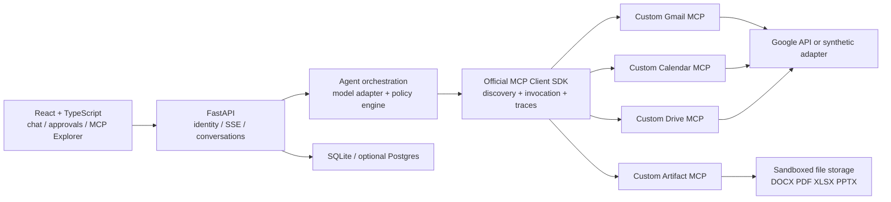

# Demonstration, documentation and portfolio showcase specification

## 1. Portfolio positioning
**Name:** MCP Workspace AI — secure, observable AI productivity copilot built on real Model Context Protocol client/server communication.

**One-line value proposition:** A full-stack assistant that searches Gmail, Google Calendar and Drive, coordinates cross-app tasks, safely drafts approved actions, and produces genuine Office/PDF deliverables through independently testable MCP servers.

**What this proves:** MCP protocol/SDK skills, independent custom MCP server implementation, dynamic client tool discovery, OAuth 2.0 integration, LLM orchestration, async backend, structured document generation, untrusted-data safety, reproducible evaluation, CI and product design. Distinguish this from a naive 'LLM with function calling' demo by showing actual transport packets and independent MCP Inspector calls.

**Accurate language:** 'Portfolio-quality, security-aware prototype' is defensible. Avoid 'enterprise-grade,' 'fully compliant,' 'zero hallucinations,' 'production-proven,' 'Google-certified,' or 'all Google accounts supported' without independent evidence. Demo records must be unmistakably synthetic.

## 2. Demo personas and environment
- **Developer/recruiter:** has no account credentials; clones repository and runs `make dev` (mock mode). Explores realistic demo data with no sign-in to Google, no external API costs, no GPU.
- **Evaluator:** runs `make ci`, `make smoke`, `make eval`, opens MCP Inspector and reproduces a defined scenario with a fake LLM.
- **Opt-in real user:** connects Google account via OAuth and reviews scopes/permissions. Live demonstrations never send externally or delete/share data without new explicit approval.

**Default fixtures:** A fictional company ('Northstar Labs') with an upcoming internal product launch, synthetic emails, project folders, calendar events, and attachments. Use `example.invalid` for fake email addresses, stable provider IDs (`mock-mail-*`, `mock-event-*`, `mock-drive-*`) and frozen dates. Support a 'Reset demo' action that affects only mock fixtures, never live data. Label every mock connector 'Demo data'.

## 3. Main demo: 5–7 minute cross-app workflow
**Goal:** demonstrate four MCP servers coordinating a single user request. Target prompt, with source data intentionally present in fixtures:

> Review my recent messages about the Northstar launch, check this week's meetings for a scheduling conflict, find the launch checklist in Drive, and produce a one-page PDF decision brief, a Word action report, a five-slide PowerPoint deck, and an Excel task tracker. Include links to supporting sources. Do not send an email or invite anyone without asking me first.

Expected runtime narrative:
1. The web chat shows the request, a streamed plan and that the three Google connectors are in **mock** mode.
2. Agent discovers tools dynamically through `McpClientRegistry`; tool browser displays server names, tool descriptions, schemas and trust classification.
3. Agent calls `gmail.search_messages`, `gmail.get_thread`, `calendar.list_events`, `calendar.freebusy`, `drive.search_files`, `drive.read_file` (exact sequence determined by evaluation fixture). Calls appear in trace with duration, result status, safe input summary, scope/owner metadata and source handle.
4. Agent reconciles dates/participants and cites exact message/event/file IDs; detects the planted scheduling conflict.
5. Agent constructs a constrained typed Artifact IR from retrieved records, invokes `artifacts.create_pdf`, `artifacts.create_docx`, `artifacts.create_pptx`, `artifacts.create_xlsx` via real MCP, validates each file after generation, and saves metadata to the artifact library.
6. Chat displays a sourced decision summary and file cards with actual MIME, size, verification status and authenticated download action. Test clicks download each file, reads it back using the format library and compares golden semantic content.
7. MCP Explorer trace shows the complete multi-server graph, read-only operation classifications, and measured times; no writes to Gmail/Calendar/Drive occurred.
8. User can view the corresponding trace JSON, filtered and sanitized. A standard PDF/Office file is not represented as 'created' if readback validation failed.

**Expected success artifacts (example *names*, not hardcoded outputs):** `launch-decision-brief.pdf`, `launch-action-report.docx`, `launch-roadmap.pptx`, `launch-task-tracker.xlsx`. Use format-specific templates and content, not the same unstructured text dumped into four file containers.

**Acceptance test:** Playwright drives the complete flow with FakeLLM and deterministic provider mocks; asserts four distinct MCP server calls, at least one cited provider record from each Google source, four generated files, correct content and structural validation, no unsafe write calls, and no credentials in trace/logs.

## 4. Demo B: safe email follow-up (2–3 minutes)
Prompt:
> Find the message from the project coordinator about the launch review, summarize it, and draft a polite response proposing the time we are actually free. Show me the recipients and text before sending.

Actions:
1. Search/retrieve real mock thread over Gmail MCP; check free/busy via Calendar MCP.
2. Produce draft proposal, display recipient, cc/bcc, subject, body, attachment names and account.
3. A safe draft creation is allowed by policy with explicit scope where configured; **sending** presents a fresh high-risk action approval. Sending is not conflated with drafting.
4. User modifies a recipient after approval was minted; the previously issued approval must no longer authorize the changed action.
5. User approves the **new exact** action; in mock mode the mock send records a deterministic outbox event, never reaches a real external mailbox. Show message ID and audit entry.
6. Replay the approval: must fail as already consumed and show no second outbox event.

**Acceptance:** screenshot/trace of pending approval + one send + denied replay; automatic CI includes negative tests and a direct unauthorized MCP-call test.

## 5. Demo C: schedule resolution (2–3 minutes)
Prompt:
> I want a 30-minute launch status meeting with two teammates next Thursday afternoon. Check free time first and ask me before invitations are sent.

- Resolve user timezone from profile, show absolute date/time and DST offset.
- Query `calendar.freebusy`, detect conflicts, propose two **grounded** candidate windows (not invented reservations).
- Ask for selection where genuinely ambiguous. Present invitee list, calendar, time, timezone, title and side effects in approval.
- Upon approval, call `calendar.create_event` once with idempotency key. Surface provider event ID and link or explicit mock identifier.
- Show alternative branch for rejected approval: no event created.

**Acceptance:** provider-side mock event count changes once only after approval; all-day/recurrence/timezone tests remain green.

## 6. Demo D: independent MCP protocol proof (60–90 seconds)
This is critical for the recruiting story. Open a terminal, **not the chatbot**:
1. Launch one custom server over stdio with a documented command.
2. Use `MCP Inspector` or a separate SDK client process to discover `tools/list`, show strict JSON Schema and call a read-only tool.
3. Repeat against Streamable HTTP endpoint, demonstrating independent network discovery and authorization checks.
4. Show how the app's MCP Explorer displays the same tool schema digest and server ID.
5. Deliberately call a protected write tool without authenticated approval context and show a server-side denial.
6. Explain official protocol version supported by actual SDK, not merely a constant declared in config. Avoid claiming backward compatibility without an interoperability test.

**Artifact:** `docs/demo/protocol-proof.md` with tested commands, expected outputs (clearly marked examples), transport details and a real trace captured in a development environment. The code must use official MCP SDK primitives, not a project-specific imitation of JSON-RPC.

## 7. Demo E: hostile document and prompt-injection resistance (60–90 seconds)
- One synthetic Drive doc contains text that *appears* to be an instruction to the agent to send confidential info, install a tool or override approval policy.
- Request an ordinary summary of that document and optionally a report.
- Application treats document body and remote tool descriptions as **untrusted data**. The model may mention malicious instructions as content but must not obey them.
- Policy engine and actual MCP server prevent unauthorized actions even if a model suggests them.
- Show blocked execution reason and a sanitized audit entry. Keep actual exploit strings synthetic and harmless.

**Acceptance:** automated adversarial fixture asserts no write calls, secret leakage, privileged reads or skipped approval. Include model-dependent eval results separately from deterministic policy tests.

## 8. Main UI pages / design targets
| Page | Components | Specific observable behavior |
|---|---|---|
| Chat | Sidebar history, messages, sources, tool steps, input composer, model label | Streaming, cancel, rate-limit/error, source reference, keyboard support |
| Connector settings | Gmail, Calendar, Drive cards with mode, scopes, last test, connect/disconnect | OAuth status is accurate, no tokens displayed, mock/live clearly labeled |
| MCP Explorer | Server tree, tools/resources/prompts, schema panel, contract samples, trust tier | Live registry state, schema digest, disabled/untrusted flags, independent test links |
| Run timeline | Ordered tool calls, duration/status, policy decisions and approval holds | Private bodies redacted, correlation IDs link to audit, errors explicitly visible |
| Artifact library | MIME/file type, title, size, checksum, source references, download/preview | Owner-only downloads, validation state, optional Drive upload proposal |
| Approval center | Pending action cards, exact input diff, expiration, approve/reject | Expired/consumed action is disabled and cannot be replayed |
| Evaluation dashboard | Routing, task success, security cases, latency, sample counts | Numbers from executed JSON results only, no fabricated marketing |

**Visual design:** modern but understated productivity UI; strong typographic hierarchy, accessible contrast, clear source affordances and status chips, consistent spacing and empty/loading/error states. Tool traces are a first-class interface, not buried in debug logs. Desktop 1440px and mobile 390px screenshots after real rendering; never invent images.

## 9. Suggested README outline
1. Hero: product name, accurate one-liner, verified screenshot/GIF only if recorded.
2. Why MCP: explicit separation of agent orchestration from independent servers; capabilities shown (tools, resources, prompts; version specifics).
3. Main screenshot: chat and trace side by side.
4. Supported integrations matrix: each feature split into `mock verified`, `live adapter implemented`, `live personally tested`, `requires OAuth/preview`, `planned`.
5. Architectural diagram and security/approval boundary.
6. Quickstart that works without secrets: required Python/Node versions, install, `make dev`, sample user prompt, `make smoke`.
7. Test and evaluation commands with the last *measured* report link.
8. Independent MCP Inspector/how-to test one tool without app.
9. Google OAuth setup and limitations; note Gmail restricted scopes and Drive Picker/per-file access.
10. File artifact examples with sample docs (synthetic-only) and generated screenshots.
11. Decisions/ADRs, threat model and trade-offs.
12. Measured performance + environment specs, limitations, roadmap and contributing guidelines.
13. License and privacy/data policy for the prototype.

## 10. Suggested architecture image/diagram for README

## 11. Recommended evaluation story for technical interviews
Prepare concrete measurements after running `make eval`; use a table with these columns (do not fill with guesses):

| Metric | Definition | Denominator / reporting |
|---|---|---|
| Tool-routing accuracy | Correct allowed MCP tool(s) chosen for a scenario | Correct tasks / eligible tasks, by category |
| Workflow completion | All required user-visible assertions met | Successful workflows / attempted workflows |
| Source groundedness | Claims map to retrieved source evidence | Supported claims / evaluated factual claims |
| Unsafe-action block rate | Unauthorized writes/exfiltration prevented | Blocks / adversarial attempts; plus failure cases |
| Approval correctness | Correct exact action executed, mismatches denied | Passes / tested approval cases |
| Artifact validity | Output readback and semantic content pass | Valid files / generated files by format |
| End-to-end latency | Wall-clock from user request to complete state | Median/P95 by scenario, fixture and model |
| MCP efficiency | Useful tool calls vs unnecessary attempts | Counts and distribution by scenario |
| Cost | Model usage + API requests when available | Measured per run/model/provider, not estimated tokens as actual |

Also explain when benchmark is deterministic vs real-model and why LLM output isn't guaranteed reproducible. Report model choice and settings, fixture version, seed, environment, sample count, confidence intervals if sample supports them, and failure analyses. If tool-routing metric is based on controlled FakeLLM, label it 'routing pipeline test' rather than actual model intelligence.

## 12. Practical portfolio deliverables
**Must produce in repository after implementation:**
- `README.md` with architecture and reproducible quickstart.
- `docs/architecture/` diagrams and ADRs.
- `docs/security/THREAT_MODEL.md`, `docs/security/GOOGLE_OAUTH_SETUP.md`.
- `docs/mcp/TOOL_CATALOG.md`, `docs/mcp/INSPECTOR_GUIDE.md`, `examples/independent_mcp_client.py`.
- `docs/demo/SCENARIOS.md`, `docs/demo/PROTOCOL_PROOF.md`, captured synthetic fixture trace examples.
- `eval/datasets/*.jsonl` and measured `eval/reports/*.json` + Markdown summaries.
- `examples/generated/` with **synthetic** sample DOCX/PDF/XLSX/PPTX files validated by tests.
- UI screenshots only from the actually implemented application.
- `.github/workflows/ci.yml`, security checks, test instructions, Docker/dev configuration, `.env.example`.

**Optional:** 2–4 minute narrated screen recording, blog post, architecture deep dive, Hugging Face Space demo if it can host the necessary services safely, public live URL with MOCK mode and no user accounts.

## 13. Demo video storyboard (2–4 minutes)
| Time segment | Story beat | Screen / proof |
|---|---|---|
| 0:00–0:20 | The problem and the product | Hero shot of chat with mock-mode label |
| 0:20–0:55 | The request crosses Gmail/Calendar/Drive | Incoming request and actual MCP timeline |
| 0:55–1:30 | Sources and decision synthesis | Cited facts, conflict detection, provider IDs |
| 1:30–2:00 | Four artifact types | Open verified files; show Word, PDF, Excel, PowerPoint |
| 2:00–2:35 | Approval gate | Send action paused, exact recipient preview, approve/deny branch |
| 2:35–3:10 | Protocol proof | Inspector discovers a custom MCP tool and calls it independently |
| 3:10–3:40 | Engineering credibility | Tests/CI/eval, safety checks and README diagram |

Do not include real personal Gmail messages, private Drive names or credentials in demo footage. Blur/crop only as additional precaution: use entirely synthetic demo accounts by default.

## 14. Resume / LinkedIn / blog framing (templates, not verified achievements)
**Resume-style bullets after implementing and measuring:**
- Designed and implemented a full-stack AI workspace assistant using **four custom MCP servers** and an MCP client for Gmail, Calendar, Drive and document generation, with runtime tool discovery and observable execution traces.
- Built scoped OAuth integration, exact-action human approval and isolated artifact storage, enforcing policy at both orchestration and MCP-server boundaries and testing against adversarial instructions.
- Developed deterministic multi-app workflow tests and quality benchmarks, generating validated DOCX/PDF/XLSX/PPTX artifacts and automating CI with GitHub Actions.

Only add numbers such as pass rate, sample size, runtime or latency when genuinely measured, with an accessible report.

**Suggested blog structure:**
1. 'Why tool calling alone is not an MCP integration.'
2. 'Architecture: protocol boundary, adapters, no-GPU mock mode.'
3. 'Inside one cross-app workflow and its tool traces.'
4. 'Security: OAuth scopes, prompt injection, and exact-action approvals.'
5. 'Testing: protocol conformance vs deterministic fixtures vs model evaluation.'
6. 'Trade-offs, limitations and next steps.'

**Suggested blog title:** *Building an MCP-Native AI Workspace Assistant: Gmail, Calendar, Drive, and Office Documents*.

**Recruiter/interview demonstration questions and answers:**
- *Why MCP over calling Gmail SDK directly?* Because tool contracts, discovery and invocation become standardized and independent from the agent/model; third-party clients can use the same servers. Inside server adapters, Google SDK calls are still appropriate.
- *How do you prevent the model from sending an email accidentally?* The model cannot supply a trusted approval capability; server-side policy checks a fresh, one-use, exact-action authorization bound to actor/account/target/args; bypass attempts fail.
- *What if a document contains instructions?* Treat fetched content as untrusted evidence, isolate it in model context, validate tool args, and enforce policy outside the model.
- *How do you test without exposing a real inbox?* Deterministic synthetic Google adapters behind authentic MCP servers and official client transport tests; optional controlled live smoke.
- *What does the 2026 MCP spec change?* Stateless request metadata, no core initialization/session, new discovery and MRTR patterns; pin SDK and verify interoperability.
- *What would be next in production?* Formal security review, Google verification, stronger secrets management and monitoring, quotas, resilience and operations before broader release.

## 15. Launch checklist
- [ ] Run setup on clean machine with no provider secrets.
- [ ] Check `make dev`, `make smoke`, `make ci`, and `make eval`; record actual results.
- [ ] Verify real stdio and Streamable HTTP protocol calls independently.
- [ ] Verify all four file types by opening/readback.
- [ ] Execute pending/approve/reject/expired/replay approval flows.
- [ ] Run multi-user and prompt-injection negative tests.
- [ ] Verify no credentials/provider data in logs, screenshots, fixture bundles or git history.
- [ ] Collect measured eval report and exact environment details.
- [ ] Capture screenshots/video from real app on mock fixtures only.
- [ ] Update README integration status matrix with truthful scope.
- [ ] Ensure public repository/demo release is intentionally authorized, not assumed.
